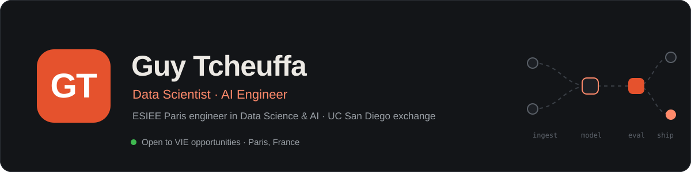
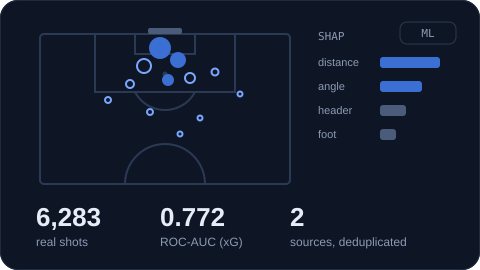

### About

I build data and AI systems end to end: from collecting messy real-world data to a model or an LLM pipeline, then an interface people can use.
What I care about most is **knowing how well it works**. Every project below ships with its own evaluation, its numbers, and a section on what doesn't work yet.

- **LLM applications that don't make things up**: retrieval-augmented generation with citations, refusals when the source is silent, outputs checked against the source text.
- **Data pipelines**: ingestion from APIs and scraped sources, cleaning, deduplication across sources, analytical storage with SQL.
- **Machine learning you can explain**: honest train/test splits, calibration, SHAP explanations.
- **Automation**: turning repetitive monitoring work into a scheduled, tested pipeline.

### Selected projects

<table>
  <tr>
    <td width="50%" valign="top">
      
      <h4><a href="https://github.com/guytcheuffa/dbt-docs-assistant">dbt docs assistant</a></h4>
      Answers questions about dbt from the official documentation, links every claim to its section, and says so when the docs don't cover it. Hybrid search with reranking, evaluated on 90 hand-written questions.
       Python · BM25 + embeddings · reranking · LLM API · Streamlit
    </td>
    <td width="50%" valign="top">
      
      <h4><a href="https://github.com/guytcheuffa/psg-sports-tracker">PSG sports tracker</a></h4>
      Football event data from two sources merged and deduplicated into DuckDB, an expected-goals model trained on 6,283 real shots, and a dashboard with shot maps, player profiles and SHAP explanations.
       Python · DuckDB · XGBoost · SHAP · Streamlit · Docker · GitHub Actions
    </td>
  </tr>
  <tr>
    <td width="50%" valign="top">
      
      <h4><a href="https://github.com/guytcheuffa/veille-subventions-cinema">Film funding deadlines tracker</a></h4>
      Tracks application deadlines of French film grants across 16 official pages. An LLM extracts them into a strict schema, a deterministic layer checks every date against the source, and a static site exports them to a calendar.
       Python · Pydantic · LLM extraction · tests · <a href="https://guytcheuffa.github.io/veille-subventions-cinema/">live demo</a>
    </td>
    <td width="50%" valign="top">
      <h4>How I work</h4>
      <b>Measure first.</b> A project isn't done until it has a test set and numbers, including the bad ones.
        
      <b>Cite and verify.</b> Model outputs are checked against their source; when the source is silent, the system says so.
        
      <b>Keep it frugal.</b> Small models, caching and cost caps: the full evaluation of the dbt assistant cost €0.20.
        
      <b>Document the limits.</b> Every README has a section on what doesn't work yet.
    </td>
  </tr>
</table>

### Toolbox

**AI & retrieval:** RAG, hybrid search (BM25 + embeddings), reranking, LLM structured extraction, LLM-as-a-judge evaluation 
**Data:** API and web ingestion, cross-source deduplication, analytical SQL, feature engineering 
**Engineering:** tests, type checking, CI, Docker, cost and budget guards
