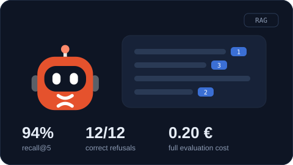
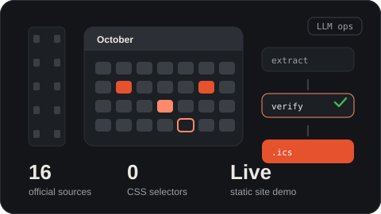

### About

I build data and AI systems end to end, from raw data to a model or an LLM pipeline people can use, and I always measure how well they work.
Engineering degree in Data Science & AI (ESIEE Paris, 2026), exchange semester at UC San Diego. Open to data and AI roles in France and abroad.

### Experience

**Data & Innovation Consulting Intern** · In Extenso Innovation Croissance, Paris · 2026 
Data cleaning and enrichment pipeline (3,179 → 1,869 qualified contacts), saving a team about 2 months of manual work.

**AI & Computational Neuroscience Research Intern** · Institut Pasteur, Hearing Institute · 2025 
iEEG signal pipeline for 20+ patients, LSTM and Transformer models, statistical validation. Reused by the team after the internship.

### Selected projects

<table>
  <tr>
    <td width="50%" valign="top">
      
      <h4><a href="https://github.com/guytcheuffa/dbt-docs-assistant">dbt docs assistant</a></h4>
      RAG assistant for the dbt documentation: cited answers, refusals when the docs are silent, evaluated on 90 questions.
       Python · hybrid search · reranking · LLM API · Streamlit
    </td>
    <td width="50%" valign="top">
      
      <h4><a href="https://github.com/guytcheuffa/psg-sports-tracker">PSG sports tracker</a></h4>
      Expected-goals model on 6,000+ real shots from two merged sources, with SHAP explanations and a dashboard.
       Python · DuckDB · XGBoost · SHAP · Streamlit · Docker · CI
    </td>
  </tr>
  <tr>
    <td width="50%" valign="top">
      
      <h4><a href="https://github.com/guytcheuffa/veille-subventions-cinema">Film funding deadlines tracker</a></h4>
      LLM extraction of French film grant deadlines, every date checked against its source. <a href="https://guytcheuffa.github.io/veille-subventions-cinema/">Live demo</a>.
       Python · Pydantic · LLM API · GitHub Pages
    </td>
    <td width="50%" valign="top">
      <h4>More</h4>
      <a href="https://github.com/guytcheuffa/nba_dashboard_"><b>NBA dashboard</b></a>: ETL from a REST API and scraping into MongoDB, multi-view dashboard, Docker Compose.
        
      <a href="https://github.com/guytcheuffa/devopps_base"><b>DevOps base</b></a>: Node.js app deployed on AWS with a CI/CD pipeline on GitHub Actions.
    </td>
  </tr>
</table>

### Toolbox

ESIEE Paris (Data Science & AI, 2026) · UC San Diego (2025) · French, English C1, Spanish B1/B2
